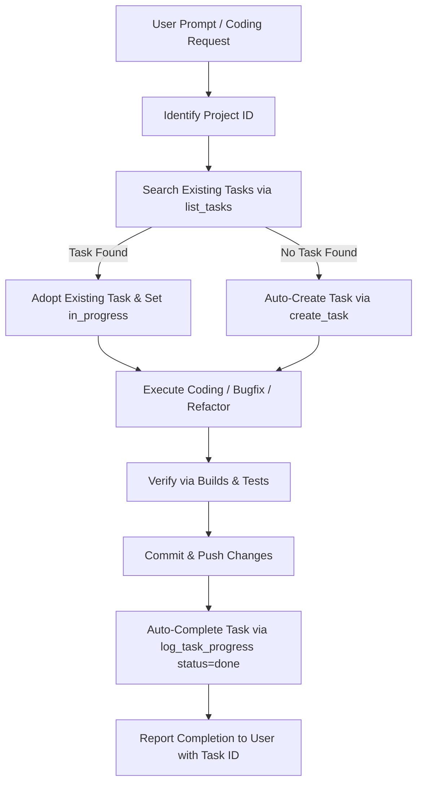

# Autonomous Task Management Skill

This skill defines the autonomous protocol for synchronizing development requests with the `task-management` MCP server. The agent must proactively manage tasks for all significant coding tasks without requiring explicit reminders from the user.

---

## 1. Project Directory Mapping

The agent automatically maps the current workspace or file context to its corresponding Project ID:

| Project ID | Project Name | Scope & Indicators |
| :---: | :--- | :--- |
| **2** | **Task-management** | `ios/`, `android/`, `backend/`, `frontend/`, `notes/` |
| **9** | **Cyber** | `cyber-mobile/`, Flutter e-commerce, Express backend, Apple Store web |
| **8** | **F-Tracker** | Finance tracker app, Nuxt 3, Elysia Bun |
| **4** | **Horus** | Horus office work |
| **6** | **Daily** | Daily routines & miscellaneous todos |
| **1** | **Career** | Interviews, job applications, portfolio |
| **3** | **Coffe** | POS coffee shop system |
| **5** | **Template** | Reusable templates, CI/CD setups |
| **7** | **Mikrotik** | Networking scripts and router configs |

---

## 2. Autonomous Workflow Protocol



### Phase 1: Task Discovery & Inception
1. **Search**: Call `list_tasks(project_id: <id>, search: "<keywords>")`.
2. **If Found**: Adopt the task ID and update status to `in_progress` if needed.
3. **If Not Found**: Create a new task via `create_task`:
   ```json
   {
     "title": "Clear Action-Oriented Title",
     "description": "Context and technical approach",
     "project_id": 2,
     "priority": "high",
     "status": "in_progress",
     "tags": ["ios", "ui-fix"],
     "subtasks": [
       "Subtask step 1",
       "Subtask step 2"
     ]
   }
   ```

### Phase 2: Execution & Quality Verification
- Work on code modifications.
- Run project quality gates (e.g. `xcodebuild`, `make check`, `npm run build`).

### Phase 3: Push & Task Closure
- When code is committed and pushed:
  ```json
  {
    "task_id": 46,
    "status": "done",
    "progress_note": "Fitur selesai diimplementasikan, diverifikasi di build, dan di-push ke repository.",
    "completed_subtask_ids": [244, 245, 246]
  }
  ```
- Inform the user in the final summary:
  `✅ Task #46 telah diselesaikan dan di-update ke status Done di Task Hub.`
